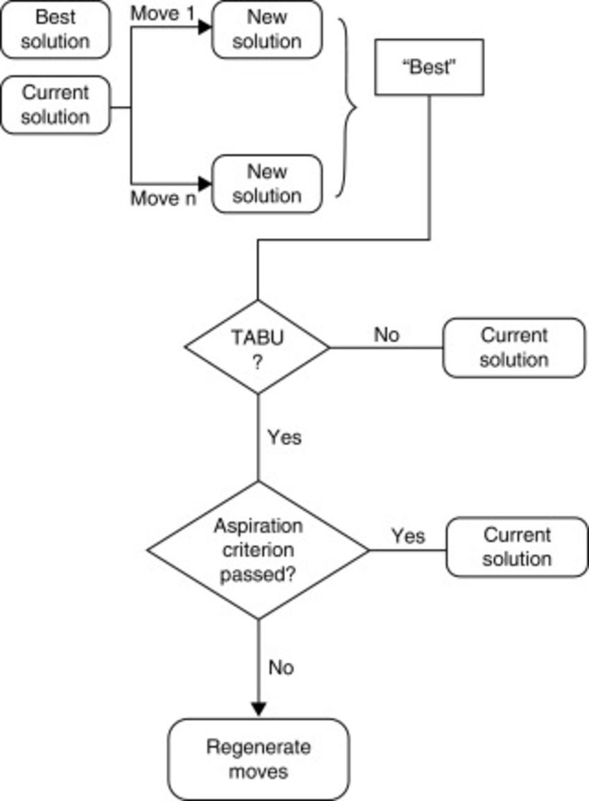
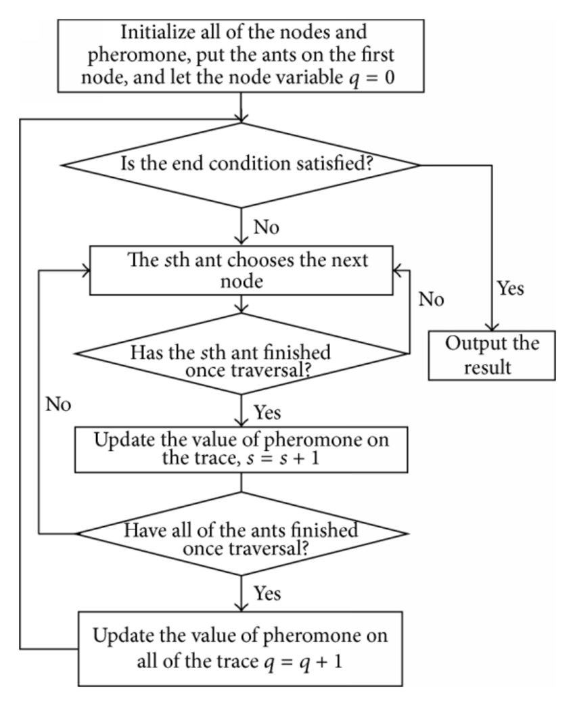

# Vehicle Routing Problem

[](https://github.com/afurculita/VehicleRoutingProblem/actions/workflows/ci.yml)

Metaheuristics for the *Capacitated Vehicle Routing Problem (CVRP)* in plain Java: two construction
heuristics (nearest neighbour, Clarke &amp; Wright savings), a **Tabu Search**, an **Ant Colony
System** with local search and a hybrid of the two, all sharing one granular neighbourhood
(relocate, Or-opt, swap, 2-opt, cross-exchange). Includes a reader for the TSPLIB /
[CVRPLIB](http://vrp.atd-lab.inf.puc-rio.br/index.php/en/) instance format, support for the
distance-constrained Golden / Li instances and [irace](https://iridia.ulb.ac.be/irace/) scenarios
for parameter tuning.

The Vehicle Routing Problem is a well known combinatorial optimization problem and a
generalization of the travelling salesman problem: a fleet of vehicles based at a single depot has
to deliver goods to a set of customers at minimal cost. Finding the optimal solution is NP-hard, so
heuristics are used to approximate it. See https://en.wikipedia.org/wiki/Vehicle_routing_problem.

The variant solved here is the CVRP. Let _G = (V, A)_ be a graph where _V_ is the vertex set and _A_
the arc set. One vertex is the depot, at which a fleet of identical vehicles of capacity _Q_ is based;
the other vertices are customers with a demand _q<sub>i</sub>_. Each arc _(v<sub>i</sub>, v<sub>j</sub>)_
has a cost _c<sub>ij</sub>_ (here: the Euclidean distance). The CVRP consists in finding a set of routes
such that:

1. each route begins and ends at the depot;
2. each customer is visited exactly once by exactly one route;
3. the total demand of the customers assigned to each route does not exceed _Q_;
4. (distance-constrained variant) the length of each route does not exceed a limit _D_;
5. the total cost of the routes is minimized.

## Quick start

Requirements: JDK 21+ and Maven 3.6.3+. There are no runtime dependencies besides
[JCommander](https://jcommander.org/) (command line parsing), and the build only needs Maven Central.

```bash
mvn package                              # compiles, runs the tests, builds target/vrp-2.0.0.jar
java -jar target/vrp-2.0.0.jar -alg tabu   -i datasets/small/A-n32-k5.vrp --seed 1
java -jar target/vrp-2.0.0.jar -alg acs    -i datasets/small/A-n32-k5.vrp --seed 1
java -jar target/vrp-2.0.0.jar -alg hybrid -i datasets/big/X-n101-k25.vrp --seed 1
java -jar target/vrp-2.0.0.jar --help
```

Example output:

```
Instance: A-n32-k5 (31 customers, capacity 100, at least 5 vehicles)
Algorithm: tabu
Seed: 1
Execution Time: 2296 ms
=========================================================
Vehicle 0: 0 -> 21 -> 31 -> 19 -> 17 -> 13 -> 7 -> 26 -> 0
Vehicle 1: 0 -> 24 -> 27 -> 0
Vehicle 2: 0 -> 30 -> 16 -> 1 -> 12 -> 0
...

Best Value: 784.0000
```

The `Best Value:` line is what the irace scripts parse; its format is stable.

### Command line options

| Option | Applies to | Default | Meaning |
| --- | --- | --- | --- |
| `-alg`, `--algorithm` | all | required | `greedy`, `savings`, `tabu`, `acs` or `hybrid` (ACS followed by tabu search) |
| `-i`, `--instance` | all | required | path to a `.vrp` file |
| `--seed` | all | random | random seed; the seed used is always printed, so any run can be reproduced |
| `--distances` | all | `auto` | `auto` (rounded for the A/B/P/M/X sets, exact for Golden/Li), `exact` or `rounded` (see below) |
| `--granularity` | tabu, acs, hybrid | 30 | size of the candidate lists restricting the neighbourhood; `0` = complete neighbourhood |
| `--iterations` | tabu, acs, hybrid | 10000 / 100 | tabu, hybrid: consecutive non-improving iterations before stopping; acs: colony iterations |
| `--tabu` | tabu, hybrid | 5 | base tabu tenure in iterations (a random 0–4 is added) |
| `--penalty` | tabu, hybrid | 0.1 | frequency penalty factor λ of the long-term memory; `0` disables it |
| `--init` | tabu | `savings` | initial solution: `greedy` or `savings` |
| `--alpha` | acs, hybrid | 1.0 | exponent of the pheromone trail τ |
| `--beta` | acs, hybrid | 2.0 | exponent of the visibility η = 1/d |
| `--rho` | acs, hybrid | 0.1 | global pheromone evaporation / deposit rate, in (0, 1) |
| `--omega` | acs, hybrid | 0.1 | local pheromone update rate, in [0, 1] |
| `--q0` | acs, hybrid | 0.9 | probability of the greedy (exploitation) step, in [0, 1] |
| `--ants` | acs, hybrid | 10 | ants per iteration; `0` = one ant per customer |
| `--local-search` | acs, hybrid | `full` | local search applied to every ant: `none`, `two_opt` or `full` |
| `--acs-iterations` | hybrid | 100 | colony iterations of the ACS phase |

Exit codes: `0` success, `1` the instance could not be read or a parameter value is invalid,
`2` the command line could not be parsed.

### Using the solvers from Java

```java
VrpInstance instance = VRPLibReader.read(Path.of("datasets/small/A-n32-k5.vrp"));   // DistanceMode.AUTO
CandidateLists candidates = new CandidateLists(instance, 30);
Solution tabu = new TabuSearchSolver(instance, 5, 10_000, 0.1, new Random(1), candidates).solve();
Solution acs = new AntColonySystemSolver(instance, AcsParameters.DEFAULT, new Random(1), candidates).solve();
Solution polished = new TabuSearchSolver(instance, 5, 10_000, 0.1, new Random(1), candidates).solveFrom(acs);
tabu.getCost();      // 784.0
tabu.getRoutes();    // [[21, 31, 19, 17, 13, 7, 26], [24, 27], [30, 16, 1, 12], ...]  (customers only; the depot is node 0)

// the building blocks are reusable: a plain local-search descent from any feasible solution
List<List<Integer>> improved = new LocalSearch(instance, candidates).improve(instance, acs.getRoutes());
```

`Solution.of(instance, routes)` validates that every customer is served exactly once and no route
exceeds the capacity or the maximum route length, so a solver can never return an infeasible
solution unnoticed.

## Project layout

```
src/main/java/ro/uaic/info/
  VRPRunner.java                 command line entry point
  VRPLibReader.java              TSPLIB / CVRPLIB parser (both dialects, distance modes)
  VrpInstance.java               immutable problem data (demands, distances, capacity, route-length limit)
  Solution.java                  routes + cost, feasibility checks, output formatting
  Solver.java                    the interface every algorithm implements
  greedy/GreedySolver.java       nearest-neighbour construction heuristic
  greedy/ClarkeWrightSolver.java Clarke & Wright parallel savings heuristic
  tabu/TabuSearchSolver.java     tabu search (short- and long-term memory, perturbation)
  acs/AntColonySystemSolver.java ant colony system with candidate lists and local search
  acs/AcsParameters.java         ACS parameter record with validation
  local/Neighbourhood.java       granular relocate / Or-opt / swap / 2-opt / cross-exchange scanner
  local/RouteState.java          mutable working solution (routes, loads, lengths, position index)
  local/Move.java                move records carrying the arcs they create and destroy
  local/LocalSearch.java         best-improvement descent over the neighbourhood
  local/CandidateLists.java      k nearest neighbours of every node
  local/TwoOpt.java              stand-alone intra-route 2-opt (cheap ACS local search)
src/test/java/                   JUnit 6 test suite (run with `mvn test`)
datasets/small/                  Augerat A, B and P instances (16–101 nodes)
datasets/big/                    Christofides M, Uchoa X, Golden and Li instances (101–1200 nodes)
tuning/{tabu,acs}/               irace scenarios
```

## Instances

Instances come from [CVRPLIB](http://vrp.atd-lab.inf.puc-rio.br/index.php/en/) in the
[TSPLIB95](https://www.iwr.uni-heidelberg.de/groups/comopt/software/TSPLIB95/tsp95.pdf) format.
Two dialects are supported:

* the standard one (A, B, P, M, X sets): all nodes, depot included, are listed in
  `NODE_COORD_SECTION` and the depot is node 1;
* the Golden / Li one: `EDGE_WEIGHT_TYPE: FUNCTION` with `EDGE_WEIGHT_FORMAT: EUC_2D`, only the
  customers are listed and the depot is given as an `x y` pair in `DEPOT_SECTION`.

Internally the depot is always node `0` and customers are `1 .. n-1`.

**Distance rounding.** TSPLIB defines `EUC_2D` distances as Euclidean distances *rounded to the
nearest integer*, and the best known values of the A, B, P, M and X sets use that convention. The
Golden and Li sets are evaluated with real-valued distances. `--distances auto` (the default) applies
the convention matching the dialect, so costs are directly comparable to CVRPLIB; `exact` and
`rounded` force one or the other.

**Route length limits.** Twenty of the Golden and Li instances declare a maximum route length
(`DISTANCE`). It is enforced by every construction heuristic, by every move of the neighbourhood
and by `Solution.of`, so the solvers handle the distance-constrained CVRP as well.

## Algorithms

### Construction heuristics

*Greedy (nearest neighbour)*: starting at the depot, the vehicle repeatedly drives to the closest
unserved customer that still fits. When nothing fits, the route is closed and a new vehicle starts.
Its cost is the C<sub>nn</sub> that initialises the pheromone trails of the ACS.

*Clarke &amp; Wright savings* (`-alg savings`): every customer starts in its own route; merging the
routes ending in _i_ and starting in _j_ saves _d(0,i) + d(0,j) − d(i,j)_. Merges are performed in
decreasing order of savings while capacity and route length allow. It is typically 10–15% better than
nearest neighbour and is the default starting point of the Tabu Search.

### The shared neighbourhood

Both metaheuristics work on the same move set (`local/Neighbourhood.java`), evaluated in O(1) per
move from the arcs it changes:

* **relocate / Or-opt**: move a segment of 1–3 consecutive customers anywhere (including into a new
  empty route), in either orientation;
* **swap**: exchange two customers, within a route or across routes;
* **2-opt**: reverse a segment of a route;
* **cross-exchange** (2-opt*): exchange the tails of two routes.

Capacity and route-length limits are checked for every move. The neighbourhood is *granular*
(Toth &amp; Vigo): only moves that create at least one arc between a node and one of its
`--granularity` nearest neighbours are generated (plus every move touching the depot), which turns a
scan from O(n²) into O(n·k). `--granularity 0` scans the complete neighbourhood.

### Tabu Search

Tabu search is a metaheuristic that drives a local search beyond local optima: at every step the
best move of the neighbourhood is applied *even if it worsens the solution*, and recently reversed
attributes are declared *tabu* (forbidden) for a number of iterations so that the search does not
immediately come back.



Implementation (`tabu/TabuSearchSolver.java`):

* **Start**: the savings solution (`--init greedy` for nearest neighbour).
* **Neighbourhood**: the shared granular neighbourhood above, scanned completely at every iteration.
* **Short-term memory** (tabu attributes): a moved customer may not be moved again; a customer that
  left a route may not re-enter it; a broken arc may not be rebuilt. Tenure = `--tabu` + random(0..4)
  iterations. Because each iteration freezes two or three customers, short tenures (5–10) work best.
* **Aspiration**: a tabu move is accepted when it yields a new best solution.
* **Long-term memory**: a worsening move is penalised in proportion to how often the customers it
  moves have been moved already (frequency-based diversification, Taillard): a customer moved at the
  average rate adds `--penalty` × (average cost per customer) to the move's score.
* **Perturbation**: after 50 consecutive non-improving iterations the search restarts from the best
  solution kicked by `max(3, n/10)` random moves, whose attributes are made tabu so the kick cannot be
  undone right away. The same kick is used when every move is tabu.
* **Stopping**: `--iterations` consecutive iterations without improving the best solution.

```
s      ← savings solution;  best ← s;  tabu ← ∅;  freq ← 0
while iterations without improvement < maxIterations
    m ← argmin over N(s) of delta(m) + penalty(freq, m), skipping tabu moves unless they improve best
    s ← s ⊕ m;  mark the attributes reversed by m tabu for tenure iterations;  freq[moved customers]++
    if cost(s) < cost(best): best ← s
    every 50 stagnating iterations: s ← perturb(best)
return best
```

### Ant Colony System

Ant Colony Optimization is inspired by the foraging behaviour of real ants. Artificial ants build
solutions step by step, guided by *pheromone trails* τ(i, j) that summarise how good arc (i, j) was
in previous solutions, and by the *visibility* η(i, j) = 1 / d(i, j).



The implementation (`acs/AntColonySystemSolver.java`) follows the Ant Colony System of Dorigo &
Gambardella (1997), adapted to the CVRP as in Bullnheimer, Hartl & Strauss, *Applying the Ant System
to the Vehicle Routing Problem*:

* **Construction.** An ant starts at the depot and repeatedly chooses the next customer among the
  unserved ones that still fit in the vehicle (capacity and route length); when nothing fits it
  returns to the depot and starts a new route. The choice is restricted to the candidate list of the
  current node (`--granularity` nearest neighbours) and falls back to all feasible customers when no
  candidate is feasible. Ant _k_ is forced to start with customer _k_ (rotating across iterations).
* **Transition rule** (pseudo-random proportional). With probability _q<sub>0</sub>_ the ant takes
  the arc maximising τ<sup>α</sup>·η<sup>β</sup> (exploitation); otherwise it draws the next customer
  with probability proportional to τ<sup>α</sup>·η<sup>β</sup> (biased exploration).
* **Local update.** Every traversed arc is immediately updated,
  τ ← (1 − ω)·τ + ω·τ<sub>0</sub>, which makes already used arcs less attractive to the next ants.
* **Local search.** Each ant's routes are improved before competing for the global update:
  `--local-search full` (default) runs the complete descent over the shared neighbourhood,
  `two_opt` only uncrosses routes, `none` keeps the raw construction. The full descent is what makes
  the ACS competitive (it is the ACS + local search scheme of Dorigo &amp; Gambardella).
* **Global update.** After every iteration, τ ← (1 − ρ)·τ + ρ / L<sub>best</sub> on the arcs of the
  best solution found so far.
* **Initialisation.** τ<sub>0</sub> = 1 / (n · C<sub>nn</sub>) where C<sub>nn</sub> is the cost of the
  greedy solution; 10 ants (`--ants 0` for one per customer); `--iterations` colony iterations.

Runs are reproducible for a given `--seed`. With the full local search each ant costs a descent, so
on the largest instances reduce `--iterations` or use `--local-search two_opt`.

### Hybrid

`-alg hybrid` runs the ACS for `--acs-iterations` iterations and then the Tabu Search from the
ACS's best solution. It combines the diversity of the colony with the intensification of the tabu
search and is the strongest option on large instances.

## Parameter tuning with irace

[irace](https://cran.r-project.org/web/packages/irace/vignettes/irace-package.pdf) scenarios for both
metaheuristics live in `tuning/tabu` and `tuning/acs`. They train on `datasets/small` and read the
`Best Value:` line of the program output; the seed irace draws is passed to the program with
`--seed`, so every experiment is reproducible.

```bash
mvn package
cd tuning/tabu          # or tuning/acs
irace                   # needs R with the irace package installed
```

`parameters.txt` describes the search space (tenure, budget, penalty and granularity for the tabu
search; α, β, ρ, ω, q<sub>0</sub>, ants and iterations for the ACS), `default.txt` the current
defaults, `scenario.txt` the budget. The parameter values tuned for the original implementation
(`tabu 7 / iterations 19` and `alpha 1.95, beta 4.76, rho 0.66, omega 0.85, q0 0.48`) are no longer
meaningful: the algorithms changed substantially in version 2.0 (see below) and `--iterations` now
counts non-improving iterations for the Tabu Search. Re-run irace to tune version 2.0.

## Results

Default parameters, `--seed 1`, `--distances auto` (rounded for A, B, P and X, exact for Golden), one
run per instance on one core of the CI container. "Best known" is the CVRPLIB value, so the gap is
directly comparable. Golden_1 is distance-constrained (route length ≤ 650). On the two Golden
instances the ACS ran 20 iterations (`--iterations 20`) and the hybrid's colony 10
(`--acs-iterations 10`); everything else used the defaults.

| Instance | Customers | Greedy | Savings | ACS | Tabu Search | Hybrid | Best known |
| --- | ---: | ---: | ---: | ---: | ---: | ---: | ---: |
| A-n32-k5 | 31 | 1145 | 842 | **784 (3.2 s)** | **784 (2.1 s)** | **784 (4.9 s)** | 784 |
| A-n60-k9 | 59 | 1837 | 1408 | **1354 (9.6 s)** | **1354 (7.1 s)** | **1354 (12.7 s)** | 1354 |
| A-n80-k10 | 79 | 2348 | 1840 | **1775 (14.0 s)** | 1780 (6.7 s) | pending | 1763 |
| B-n78-k10 | 77 | pending | pending | pending | pending | pending | 1221 |
| P-n101-k4 | 100 | pending | pending | pending | pending | pending | 681 |
| X-n101-k25 | 100 | pending | pending | pending | pending | pending | 27591 |
| Golden_1 | 240 | pending | pending | pending | pending | pending | 5623.47 |
| Golden_20 | 420 | pending | pending | pending | pending | pending | 1820.09 |

Timings in seconds. For comparison, the original implementation reported 822.86 / 1460.51 / 1833.87 /
1421.52 / 757.24 for the Tabu Search on the five small instances and 863.15 / 1629.55 / 2043.01 /
1479.05 / 883.51 for the ACS (real-valued distances), and 2502.39 / 2282.83 on Golden_20. Those
numbers are not reproducible (the random generator was not seeded) and some of them were produced by
code with the defects listed below; its Golden_20 figures were computed with customer 1 mistaken for
the depot.

### Conclusions

1. With a rich neighbourhood, a proper memory structure and a few seconds of CPU, the Tabu Search
   finds the optimum of the small Augerat instances and stays within 1–2% of the best known values
   on 100-customer instances.
2. The ACS lives or dies by its local search: construction alone is 15–20% off, construction + 2-opt
   10–15%, construction + the full descent reaches the same quality as the Tabu Search at a higher
   cost per iteration. The hybrid (ACS, then Tabu) is the most robust option on large instances.
3. Clarke &amp; Wright is a far better starting point than nearest neighbour and costs nothing.
4. Granular neighbourhoods (30 candidates) lose nothing measurable on these instances and make the
   larger ones tractable: the 420-customer Golden_20 is solved to 6% in under a minute.
5. There is no guarantee of optimality; results vary with the seed. Report the seed with any result.

## Tests and continuous integration

```bash
mvn test        # 94 unit tests: parser (both dialects, distance modes, error cases), instance
                # validation, solution feasibility (capacity and route length), construction
                # heuristics, candidate lists, every move type of the neighbourhood (bookkeeping
                # invariants on real instances), local search, tabu search, ACS, command line
mvn verify      # tests + executable jar
```

GitHub Actions (`.github/workflows/ci.yml`) builds the project on JDK 21, runs the tests and smoke-runs
every algorithm, including the hybrid on a distance-constrained Golden instance.

## Changes in version 2.0

The implementation was reviewed, rewritten around an immutable `VrpInstance` / `Solution` model,
and covered with tests. Defects found in the original code:

* **Tabu Search corrupted vehicle loads.** The demand subtracted from the source route after a move
  was the demand of the *last evaluated* candidate, not of the moved customer, so capacity checks
  drifted and infeasible solutions could be produced (and reported as improvements).
* **Tabu Search skipped most of its neighbourhood.** A `break` instead of `continue` on a tabu move
  abandoned the rest of the target route.
* **Tabu Search could crash or add `Double.MAX_VALUE` to the cost** when every move was tabu, had no
  aspiration criterion, could never open a new route, and used an unseeded `Random`, so irace's
  seeds were ignored and runs were not reproducible.
* **ACS never reset the ant's load** between iterations (`currentCapacity` only grew), so first
  routes became shorter and shorter; the ant placed at the depot built a tour starting `0 -> 0`.
* **Golden / Li instances were read with the wrong depot**: the depot coordinates in
  `DEPOT_SECTION` were ignored and customer 1 was used as the depot.
* The ACS came from the unmaintained `jacof` library pinned to a JitPack `master-SNAPSHOT`
  (non-reproducible builds, one thread per ant, log4j 1.x). It has been reimplemented in this
  repository with the same rules; the project now depends only on Maven Central.
* The greedy solver called `System.exit` from library code; the instance file was parsed twice; the
  parser had dead code for pickup / time-window sections and no error reporting.

Build and tooling: standard Maven layout, Java 21, JCommander 3.0, JUnit 6, maven-shade executable
jar, GitHub Actions CI, `--help`, `--seed`, `--distances`, `--ants`, `--local-search`.

### Version 2.1: shared neighbourhood, savings, hybrid, route-length limits

* One granular neighbourhood (relocate / Or-opt, swap, 2-opt, cross-exchange; `local/`) with
  incremental O(1) move evaluation, shared by a plain local-search descent, the ACS and the Tabu
  Search. Candidate lists (`--granularity`) make each scan O(n·k).
* Clarke &amp; Wright savings construction (`-alg savings`), now the Tabu Search's starting point.
* ACS: candidate lists in the construction, full local search on each ant (`--local-search`),
  10 ants by default; `-alg hybrid` chains ACS and Tabu Search.
* Tabu Search: frequency-based long-term memory (`--penalty`), kick instead of stopping when every
  move is tabu.
* Maximum route length of the Golden / Li instances enforced in every heuristic, every move and in
  `Solution.of`.
* `--distances auto` applies the TSPLIB rounding convention for the A/B/P/M/X sets, so results are
  comparable to CVRPLIB out of the box.

## Ideas for further improvement

* **Faster descents for the ACS**: first-improvement instead of best-improvement, or a "don't look
  bits" scheme, would cut the cost of the full local search several-fold and allow more ants.
* **Parallel ants**: the ants of one iteration are independent and could be built on several cores.
* **Infeasible intermediate solutions** with a self-adjusting capacity penalty (Gendreau, Hertz &amp;
  Laporte) would let the Tabu Search cross infeasible regions on the tightest instances.
* **Service times and time windows** (VRPTW): the parser already skips those sections; the
  neighbourhood would need time-window feasibility checks.
* **Multi-run statistics**: a small driver that runs several seeds and reports mean / best / standard
  deviation would make comparisons more honest than the single-seed table above.

## License

MIT, see [LICENSE](LICENSE).
